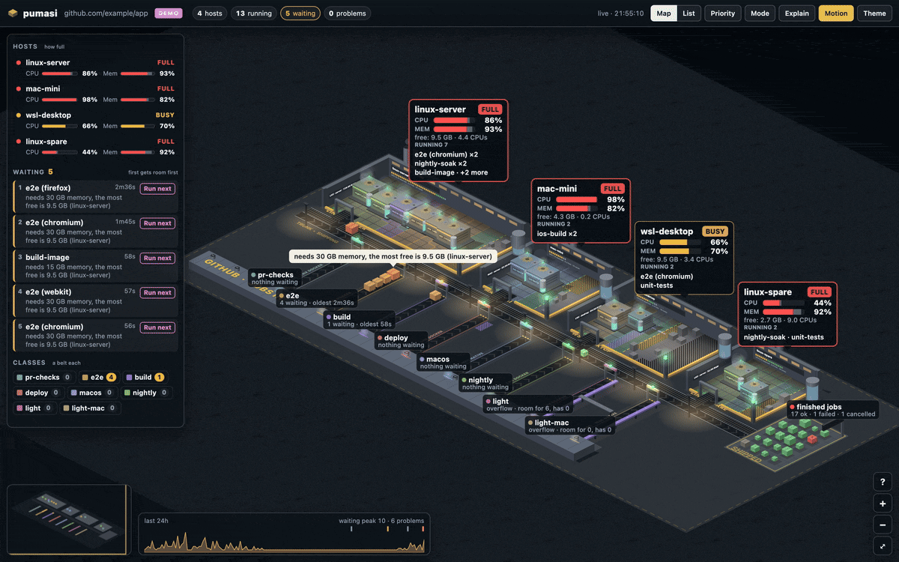
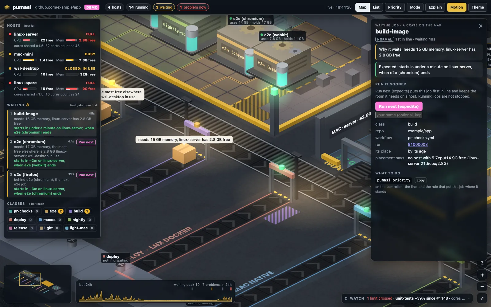
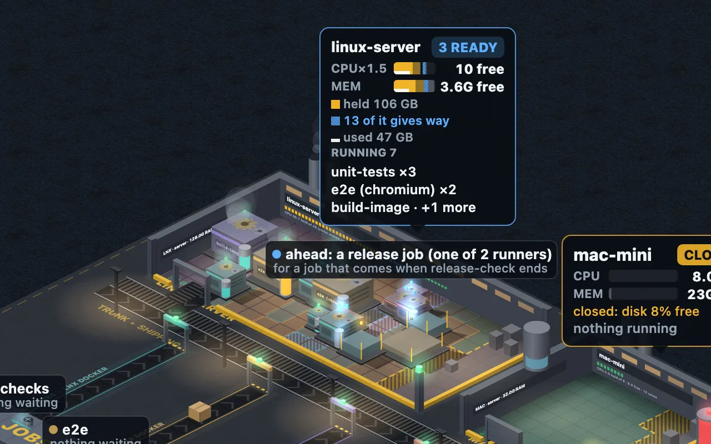
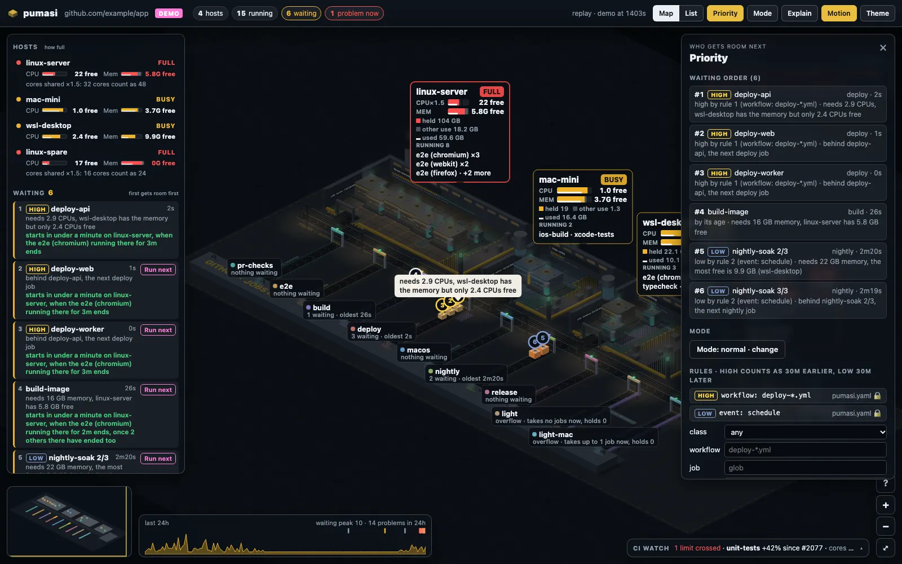
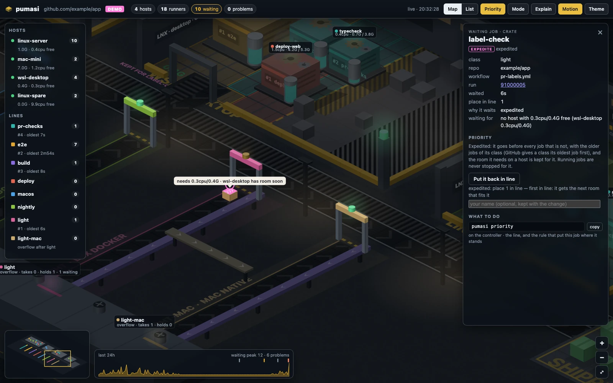
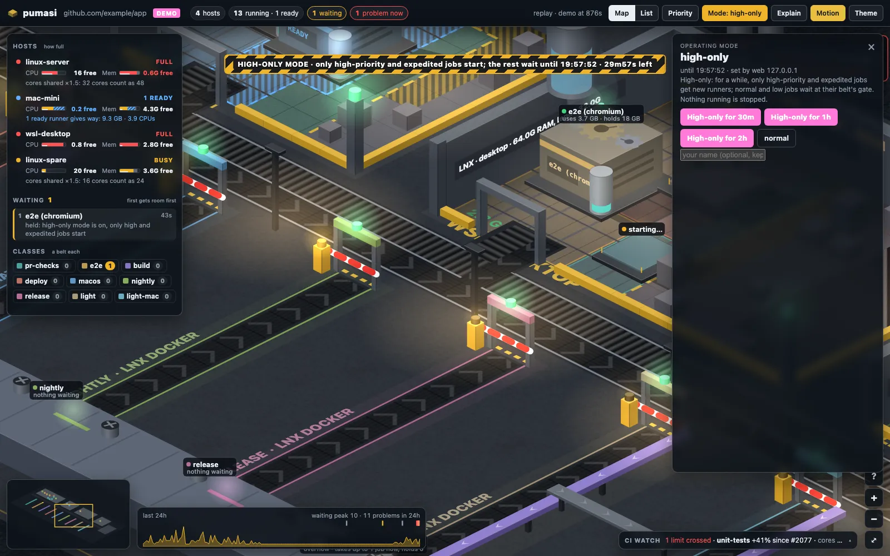
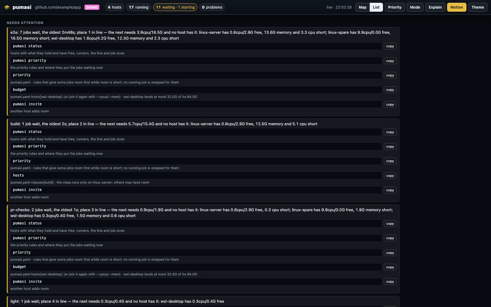
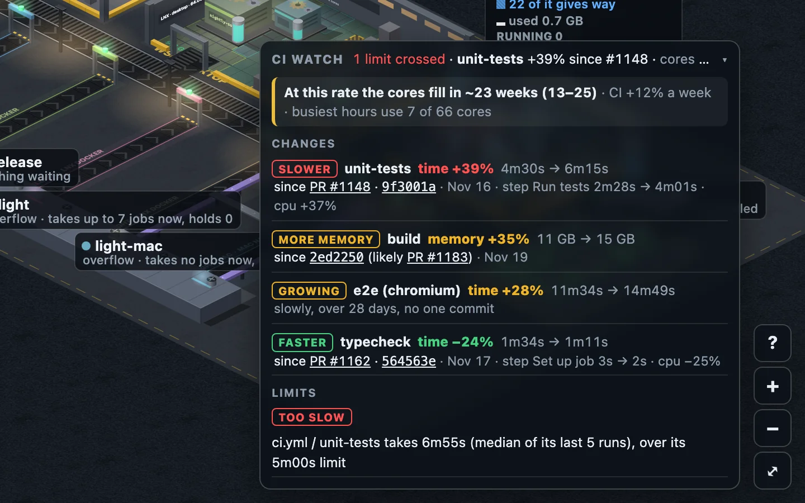
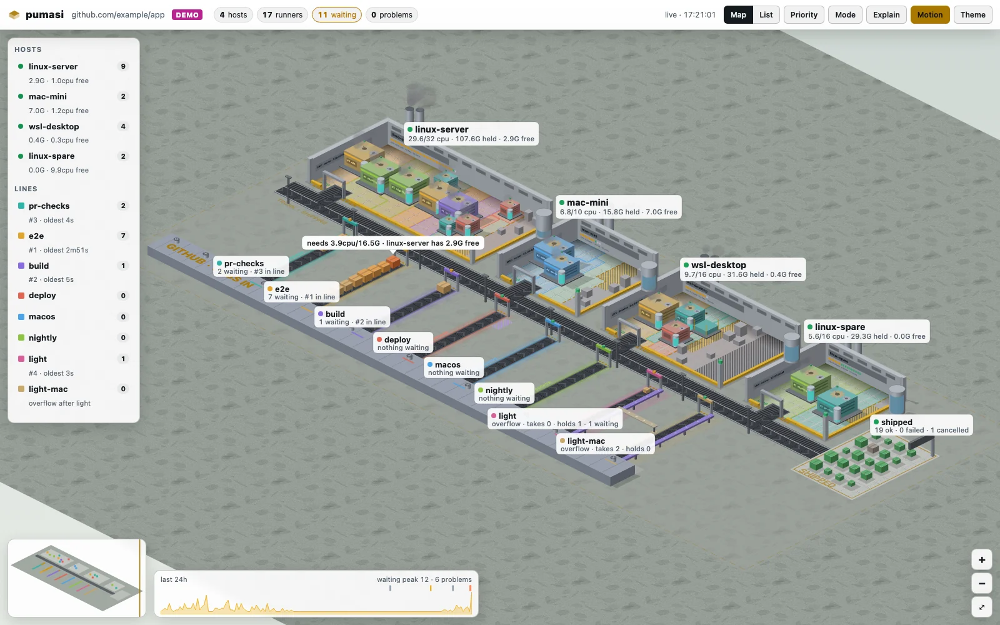
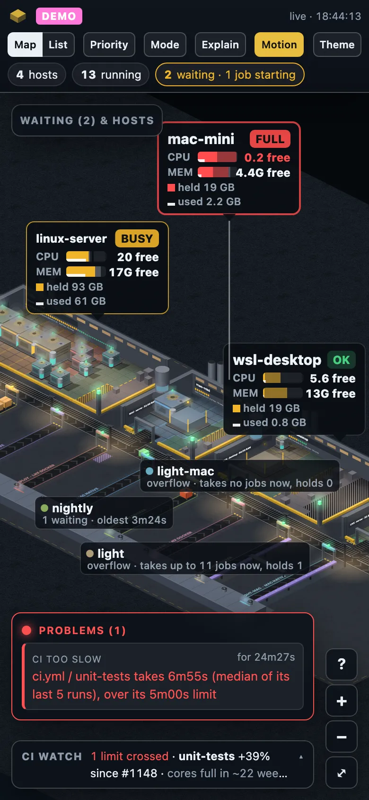

# pumasi

[](docs/img/demo.mp4)

<sub>`pumasi open --demo`, no controller and no GitHub needed. ▶ [The 58-second tour (mp4)](docs/img/demo.mp4), in close-ups: why each job waits and when it starts, the forecast coming true, ready runners stepping aside, runners started ahead, job sizes nobody wrote, CI watch, a desktop someone sits at, deploys first.</sub>

**Ephemeral GitHub Actions runners on the machines you already have, placed where the room is, by measured size, without Kubernetes.**

## Why

Fixed self-hosted runners make you guess. GitHub hands a job to any idle runner whatever the host is already doing, and a lint run and a browser e2e suite each count as "one runner". Register too few runners and a big machine sits idle while jobs queue. Register too many and three heavy jobs land on one host and starve each other, or the person working at that desktop. Leftover containers and directories from one job eat into the next.

pumasi starts one ephemeral runner per job, on the host that has room for it right now, and removes it when the job ends. It learns each job's size from the runs before it, so nobody writes CPU or memory numbers. Where room is left over, it keeps a few runners up for the jobs that usually come next, so they don't wait for one to boot, and those give way to any job that needs the room. When room is short, jobs wait in one line with a stated reason. You can raise a workflow's priority, expedite a single job, or for a while give new runners only to high-priority jobs. With an overflow class, pumasi takes only the jobs that fit and leaves the rest to your existing fixed runners. It's a single Go binary, built on GitHub's runner scale set API, the same one GitHub's actions-runner-controller uses.

## Try it in a minute

Look at the dashboard first. The demo runs the real placement code on a made-up shop of four hosts and eight classes:

```sh
git clone https://github.com/midagedev/pumasi && cd pumasi
make                          # Go 1.27; builds ./dist/pumasi and the per-OS builds hosts fetch
./dist/pumasi open --demo     # opens a browser; -seed N picks another shop, ?at=<seconds> freezes a moment
```

The demo doesn't connect to anything. The same `-seed` always shows the same scenes, and every ten minutes they repeat: someone working at a desktop, a nightly batch that waits, a deploy that goes first, a job the kernel kills at the memory limit its class sets, a host that drops off and comes back, a Mac short of disk.

## Real setup

**You need**

- **A controller machine** with Go to build. Hosts must reach one port on it (default 7411), over the same network, a VPN or a tailnet.
- **Hosts.** Linux needs Docker usable by that user and cgroup v2. macOS and Windows need nothing: runners run as that user's processes.
- **A GitHub credential** that can register runners on the repo. That's a token (a classic PAT needs `repo`, or `admin:org` for an organization, from a repo admin) or a GitHub App. The token stays on the controller. A host only ever gets a one-time registration for one runner.

**1. Config:** `pumasi.yaml` (see the [annotated example](pumasi.example.yaml))

```yaml
url: https://github.com/OWNER/REPO
classes:
  - {name: small}            # in a workflow: runs-on: [self-hosted, pumasi-small]
```

**2. Start the controller**

```sh
PUMASI_GITHUB_TOKEN=$(gh auth token) ./dist/pumasi up
```

```
11:57:40 class small  runs-on: [self-hosted, pumasi-small]
11:57:40 hosts join at [::]:7411  (`pumasi invite` prints the line to run on a host)
11:57:40 dashboard http://127.0.0.1:52673/  (`pumasi open`)
11:57:40 listening for jobs (Ctrl-C to stop)
```

**3. Join a host.** `pumasi invite` prints a one-line command (curl | sh on Linux and macOS, PowerShell on Windows). It's pinned to the controller's key and valid for one host for an hour. Run it on the host. Before joining, the host checks each requirement and names whatever is missing:

```
ok    tcp 10.0.0.5:7411 (3ms)
ok    controller certificate matches the invite
ok    token accepted, the name desk1 is free
ok    docker 27.3.1 reachable as this user
ok    cgroup v2 with memory and cpu controllers

joined as desk1 (server): lends what it has free, runs as the systemd user unit pumasi.service
```

Hosts you can reach over ssh can go in the config instead (`hosts: [{ssh: server1}]`), and `up` runs the invite there for you.

**4. Send a job:** `runs-on: [self-hosted, pumasi-small]`.

```
11:58:52 start small on desk1  takes 2.0cpu/4.0G of the free 6.0cpu/9.0G for build (the class's first estimate; …)  (small-desk1-1ea93ba5)
11:58:57 ready small-desk1-1ea93ba5  5.1s
11:59:30 job build on small-desk1-1ea93ba5
12:01:02 done build on small-desk1-1ea93ba5  succeeded
```

Ctrl-C stops only the controller. Running jobs finish on their hosts, and the next `up` adopts them. `pumasi down` removes everything pumasi created on the hosts and on GitHub. It refuses while runners are up unless you pass `--force`. `pumasi service install` keeps the controller running across crashes and reboots (Linux and macOS).

## What it does

**Placement by measured size.** A job is identified by its repo, workflow file and job name. Its next run is placed with the largest of its last 10 runs plus 20% (memory without page cache). A job never seen before starts at the class's first estimate (2 CPUs / 4 GB unless you set one), or at the size of other jobs in the same workflow. A host's room is measured live: what its runners hold, what other processes use, and a memory reserve. A host under memory pressure gets no new runners. An estimate is not a limit. A job that outgrows it keeps running and is placed bigger next time.

<table>
<tr>
<td width="50%"></td>
<td width="50%"></td>
</tr>
<tr>
<td><b>Why it waits, and when it starts.</b> GitHub only says "Waiting for a runner…". Each waiting job here says what it is short of and where, and when it is expected to start: <code>starts in under a minute on linux-server, when deploy-api ends</code>. The forecast runs placement forward over the jobs' usual run times; in a simulation of four hosts its median error was 2–16 seconds (<a href="docs/design.md">design</a>).</td>
<td><b>Runners up before the job.</b> Each class keeps a few runners ready, as many as its jobs have come at once lately, and they give way to another class's job that needs the room. When a job ends that others usually follow (<code>needs:</code>), runners for those start before GitHub asks for them.</td>
</tr>
</table>

**Any mix of machines.** Linux servers run container runners (or `driver: native`, a process of the host user). Macs and Windows PCs run native runners. A host marked `desktop` is used after the servers fill up, and gets no new runner while someone is using it (input in the last 15 minutes).

**pumasi never stops a running job to make room.** Not when it outgrows its estimate, not for a job with higher priority or expedited, not when the controller dies or restarts, not when a host's connection drops. A runner with no job yet may step aside for a waiting job. Only limits you set end a job early: a class's memory `limit` (the kernel kills the process over it, and the incident says so) and `maxDuration`. What pumasi fixes on its own and what it can't are both recorded as incidents, which can go to a webhook or a command. With `rerun: 1`, a run that failed because of pumasi is rerun once.

<table>
<tr>
<td width="50%"></td>
<td width="50%"></td>
</tr>
<tr>
<td><b>Priorities.</b> When room is short, jobs wait in one line. Rules in the config, by workflow, job, class or event, make a job <code>high</code> (counts as having come 30 minutes earlier) or <code>low</code>. A job that has waited 30 minutes passes them, so nothing starves. <code>pumasi priority</code> shows the line and why each job stands where it does.</td>
<td><b>Expedite.</b> <code>pumasi expedite &lt;job URL&gt;</code>, or one button on the dashboard, puts a waiting job before every other one and keeps room for it on a host. No running job is stopped to make room.</td>
</tr>
<tr>
<td></td>
<td></td>
</tr>
<tr>
<td><b>High-only mode.</b> <code>pumasi mode high-only --for 30m</code>: for a while, only expedited and high jobs get new runners. Other jobs wait at their gates, and everything running keeps running.</td>
<td><b>Readable by people and agents.</b> <code>pumasi status</code>, the List view and <code>GET /api/explain</code> give the same facts as text: each open problem and the command to type next. Deep links (<code>?host=</code>, <code>?job=</code>, <code>?view=priority</code>), <code>data-*</code> attributes for browser-driving tools, and <code>/metrics</code> for Prometheus.</td>
</tr>
</table>

**Moving off fixed runners.** Give a class your fixed runners' `labels` and workflows move over unchanged. `env`, `path` and `{slot}` (a per-runner number for directories that persist between jobs) recreate the runner environment. A class with `overflow: true` takes only the jobs it has room for right now. The rest go to fixed runners with the same labels, so you can move over one host at a time.

**Security in one line.** GitHub credentials stay on the controller. Hosts get one-time registrations. Container jobs see only their container. A native job sees what that host user sees, so use native classes only for repos you trust. The dashboard listens on loopback by default. Its write endpoints (expedite, mode, rules) take JSON only and, unless you set a dashboard token, only from this machine.

**Watching CI.** From the same measurements: `pumasi trend` shows each job's time day by day and the commit, pull request and step where it got slower or faster, and jobs slowly growing; `pumasi why-slow <PR URL>` says whether a pull request made CI slower and where; `pumasi forecast` says when CI's growth fills the hosts. Limits on job time, memory, wait, deadlines and CPU-hours become incidents. All of it is JSON too (`/api/trend`, `/api/why-slow`, `/api/forecast`) for agents, with measured accuracy in [docs/watch.md](docs/watch.md).



<p>


</p>

## How it works

One binary plays both roles. `pumasi up` is the controller. It keeps one GitHub runner scale set per class, a ledger of runners and measured job sizes (SQLite), and decides placement every round. Every host runs `pumasi agent`, which dials the controller over TLS pinned to the controller's key. Hosts open no ports. The agent reports what the machine has free and runs the runners it is told to. The design and the reasons behind it, set against what the scale set API allows, are in [docs/design.md](docs/design.md).

What pumasi can't do, because GitHub or the platform gives it no handle:

- **Keep a run's jobs on one machine.** Within a scale set, GitHub decides which runner gets which job.
- **Move or preempt a running job.** Killing one only leaves a failed job.
- **Enforce memory or CPU limits on macOS.** On a Mac, placement is the only protection.
- **Reach hosts behind NAT.** A host must reach the controller's `listen` address directly. There is no relay.
- **Provide VM isolation** (Tart, microVMs), other CI systems, or cloud instances. These are out of scope.

## Status

Early, pre-1.0. It has run real GitHub jobs on a Linux server (Docker), a WSL2 desktop, an Apple silicon Mac and a Windows 11 desktop. [docs/verified.md](docs/verified.md) lists every behavior of the design and how far each was checked: on real hosts, by unit tests only, or not yet run. Not yet run, among others: Windows size measurement, real host reboots, and a GitHub App end to end (the App path is unit-tested).

More: [guide](docs/guide.md) (every config key and command), [design](docs/design.md), [verified](docs/verified.md) (what was checked on real hosts and what was not), [watch](docs/watch.md) (watching CI), [research](docs/research/).

## License

[MIT](LICENSE) © 2026 midagedev
