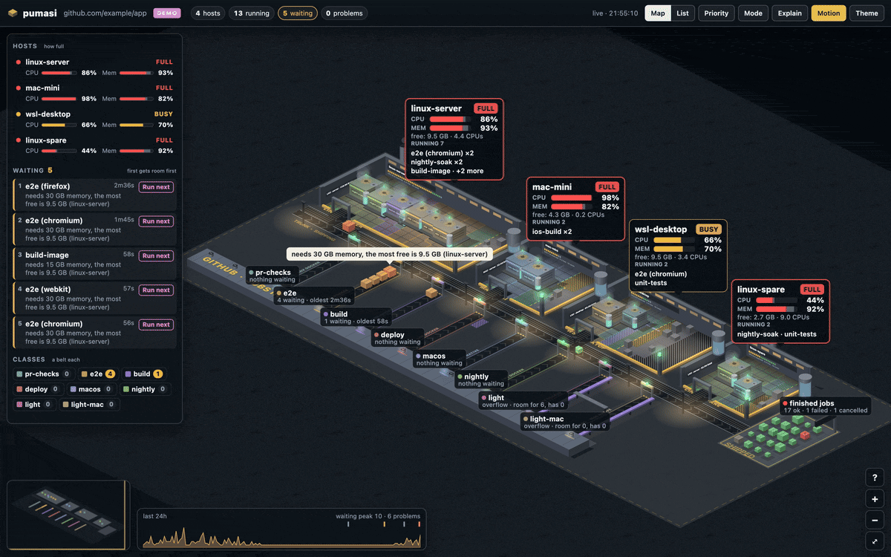

# pumasi guide

Everything the [README](../README.md) says in short. Why it was built this way is in [design](design.md), and what was actually run is in [verified](verified.md).

## Classes

A class is a kind of runner (OS, driver, paths to attach, labels). You don't need to write a size — [pumasi measures each job's size](#placement-without-numbers-to-edit). One class is one GitHub scale set (`pumasi-<name>`), and a job picks a class with `runs-on`.
`up` refuses unknown keys and two classes with the same name.

| Key | Meaning | Default |
|---|---|---|
| `name` | `runs-on: [self-hosted, pumasi-<name>]` | required |
| `labels` | Sets the scale set's labels directly. A job comes to it when all of its `runs-on` labels are in this list — write your fixed runners' labels as they are and workflows move over unchanged (below) | `[self-hosted, pumasi-<name>]` |
| `overflow: true` | **Takes only what it has room for.** Jobs that don't fit flow to other runners with the same labels (fixed runners, other classes). [Below](#taking-only-what-fits-overflow) | none — takes every job of its labels and makes them wait |
| `after: <class>` | The order between `overflow` classes. While that class has room, this class takes no new jobs | none |
| `cpus`, `memory` | **First estimate.** The size held when placing a job that has never been measured. Not a limit. Once a job has run, it is placed at its measured size | 2, 4G |
| `limit: {cpus, memory}` | Confines this class's runners to these numbers (Linux, Windows). A process that goes over the memory is killed | none — only the limit that protects the host |
| `os` | `linux` · `macos` · `windows`. Placed only on hosts of the same OS | `linux` |
| `driver` | `docker` (container) or `native` (a process of the host user — sees the host's paths, credentials and docker as they are) | `docker` on linux; only `native` on macos and windows |
| `mounts` | Attaches host paths to container runners at the same path (`/srv/cache`, `/srv/keys:ro`). Placed only on hosts that have all those paths | none |
| `hosts` | Placed only on those hosts. When the bound hosts are full it waits, even if others are empty | all hosts |
| `env` | Variables added to the runner's (and its job's) environment. What fixed runners got from a service unit or `.env` (`JAVA_HOME`, `DOCKER_HOST`, `LANG`). In a value, `{runner}` becomes that runner's directory (deleted with the runner), and `{slot}` becomes a number not shared with the runners of the same class up on that host right now (from 1, the smallest free number) | none |
| `path` | Directories to put in front of a native runner's `PATH` (a fixed runner's `.path`). Not allowed on container classes | none |
| `work` | Where to put a native runner's work directory (`_work`: checkout, node_modules, build output). Must contain `{slot}` (`/srv/ci/w{slot}`). The runner gets that slot directory (if it is a link, the real path at its end) as its work directory — the `GITHUB_WORKSPACE` and `RUNNER_TEMP` a job gets are the real location, so the job's bind mounts are visible even in a docker VM that mounts only some directories (colima: `$HOME`). It stays when the runner is gone and the next runner of that slot carries on with it — like a fixed runner's next job, `pnpm install` and checkout start warm. Without it every job starts in an empty directory (a large monorepo rewrites hundreds of thousands of files each time, which can choke disk IO) | none — deleted with the runner |
| `reserve` | Keeps room for N runners of this class that other classes can't use (so deploy jobs don't queue behind builds) | 0 |
| `warmMin` | Keeps at least N runners of this class up with no job, whether or not jobs came recently (so a once-a-day deploy doesn't wait for a runner to boot either). These N don't give way to waiting jobs of other classes — other jobs may wait that much longer. Not allowed on overflow classes | 0 |
| `maxDuration` | Stops the runner if a job runs longer than this (`90m`). The only setting with which pumasi touches a running job | none |
| `docker: inside` | Gives a container runner its own docker daemon. Containers and compose stacks the job starts count inside the class's limit and figures, and go away with the runner. The runner container becomes **privileged** | none |

```yaml
classes:
  - {name: small}                                              # container; sees nothing of the host
  - {name: e2e,     docker: inside, maxDuration: 2h}           # jobs start a compose stack
  - {name: cache,   mounts: [/srv/ci-cache]}
  - {name: build,   driver: native, hosts: [server1]}          # uses the host as it is, like a fixed runner
  - {name: deploy,  reserve: 1}
  - {name: macos,   os: macos}
  - {name: heavy,   cpus: 8, memory: 24G}                      # even never-seen jobs start out big
  - {name: fenced,  limit: {memory: 8G}}                       # jobs over 8G are killed
```

- A runner **ends with one job.** The work directory and tool caches (`setup-node` and so on) don't stay. Put what should stay between jobs in `mounts`, in a native class's host directories, or in cache actions.
- With `mounts`, the work directory goes inside the first writable mount — so pnpm, uv and ccache can hard-link from their caches.
- `driver: native` (Linux) needs a systemd user session with cpu and memory delegation, linger, and the libraries the runner reads when it starts (libicu, libssl, libkrb5, zlib, libstdc++ — what the runner's `installdependencies.sh` installs). Without them it doesn't start runners, and the host gives the reason in the wait reason. The check on joining also says it in one `note` line.
- When a native class runs as a service account rather than the logged-in user, paths only the runners should see can be given with a `BindPaths=` drop-in on that account's systemd user manager (`user@<UID>.service`). The agent (user unit) and runners (scopes) inherit those mounts, so paths a fixed runner's unit gave with `BindPaths` move over without changing the whole host. Linger must be on for that account.
- **Native runners are weakly isolated** (Mac and Windows are always native). Jobs can read and change the host user's home, credentials and global tools. Use them only for jobs of repos you trust.
- The runner version follows the tag of `image:` (default `ghcr.io/actions/actions-runner:2.338.2`). Mac and Windows read only the version number from that tag, so **if you write `:latest`, Mac and Windows runners can't start.** A person raises the version.

## Placement without numbers to edit

Nobody writes down how much a job uses. pumasi measures it and places the next run at what it measured.

- **A job's size.** Same repo, workflow file and job name means the same job (branches are not told apart; matrix jobs have their values in the name, so they are separate).
  The largest of the last 10 finished runs plus 20% is the next run's size. Memory is measured without page cache (Linux: the cgroup's anon + shmem + kernel),
  CPU as the average number of cores while the job runs. A job that grew is placed bigger from its very next run; a job that shrank gets smaller only once its big runs drop out of the last 10.
- **A job never seen before** is placed at the class's `cpus` and `memory` (2cpu/4G if unset). If other jobs of the same workflow have been measured, it borrows the largest of their sizes (never less than the first estimate).
  When the whole workflow is new, that size is a guess, so such jobs are **not placed side by side on one host all at once**: until a job has run 3 minutes, it holds 3 times the first estimate in memory, and meanwhile that host takes the next "unknown job" only when 3 times is free. After 3 minutes, what that job actually holds becomes the size of the rest. It shows in the wait reason as `it watches 1 unmeasured job there …`.
- **A host's room.** What new runners can use is the whole machine minus what runners hold, what processes outside pumasi use right now, and a memory reserve (10% of the machine, 1–4G).
  What a runner holds is the larger of its estimate and what it uses now. A host busy with other work gets fewer runners, and more again when it is idle. `budget` is only a cap on top of that.
  Under memory pressure (Linux PSI 10% or more, memory pressure on a Mac) the host gets no new runners, and the same under disk io pressure (PSI 50% or more). The host's panel shows each pressure next to its line.
- **CPU is shared, memory is not.** Short of CPU, a job only slows down; short of memory, it dies. So on a server (Linux) that measures CPU pressure (PSI), when `budget` has no cpu, what runners hold in CPU can go up to 1.5 times the cores (`cpuOvercommit`).
  When cores really run short and CPU pressure goes over 40%, that host gets no new runners. Memory stays strict. This does not apply to desktops, hosts with a cpu `budget`, or hosts without PSI (Mac, Windows).
  It shows in the start reason as `cores shared: runners hold 20.0cpu of 14.0 there, cpu pressure 12`. To turn it off, `cpuOvercommit: 1`.
- **Runners are started ahead (`warm`).** If a runner starts only after a job comes, every job waits the 8–10 seconds a runner takes to boot. So when room is left over, a few runners per class are kept up with no job, and GitHub hands them the next job at once.
  How many is learned from how many jobs of that class came at once over the last 30 minutes (0 for a class that came only once). Each holds as much room as the class's largest recent job, and stops to give way when a job of another class waits for that room.
  When someone sits at a desktop or pressure comes, the ones on that host leave at once. It shows in the start reason as `warm: kept up for the class's next job (2 of 4), …`.
  How many are kept up right now is `classes[].warm` in `/api/state`. `warm: 8` is the default cap, and `warm: 0` turns it off. When room is full there is nowhere to start them, so this uses leftover room instead of waiting; it doesn't make room.
- **Jobs that come through `needs:` are started ahead (`ahead`).** It learns pairs like e2e following unit tests from the ledger (a job that came right after the earlier job ended, in the same run), and when the earlier job's end comes within a runner's boot time, it starts a runner for the later job's class first.
  This also covers jobs `warm` can't learn, like a once-a-day deploy chain. It shows in the start reason as `ahead: e2e expected in ~6s, when unit ends …`, and `classes[].soon` in `/api/state` is the number expected now. On by default; `ahead: false` turns it off.
- **A size that fits no host.** If the measured size is more than any host of that class can lend (the machine minus the memory reserve, or `budget` if set), the job does not wait forever:
  it is cut down to what an empty host can lend and placed there **alone**. The start and wait reasons get `its size … is more than any host of <class> can ever lend (…): it runs alone on …`.
  One runner's memory is never measured above the machine's physical memory (the agent caps it). A Mac measures by adding up each process's memory, so shared memory can be counted several times —
  so a value larger than the machine in the ledger (written by an earlier version) is left out of the estimate, and noted in the estimate's source as `… left out`.
- **Going over the estimate doesn't kill the job.** The estimate is only a number placement counts, not a limit. A job that goes over runs to the end, its host gets fewer new runners meanwhile, and the next run is placed bigger.
- **The limit that protects the host** is separate (Linux, Windows): if one runner goes over 80% of the machine's memory (or `budget`'s memory if smaller), the process that went over is killed.
  It has nothing to do with the job's size; it stops one runaway job from killing every other job on that machine. CPU is not confined by default (busy only means slower).
  A job that hits that limit becomes an `out-of-memory` incident, and its next run holds 1.5 times the limit and is placed on a host with that much free (if none, it waits with a reason).
  Write `limit:` on a class only when you want to confine it more tightly.

Where to see it: `EST` (the size placement counts) and `NOW` (what it uses now) in `pumasi status`, and the `JOB SIZE` table at the bottom (next run's size · last run · recent max · number of runs); Job sizes on the dashboard.
When an estimate moves by more than a quarter, `up` logs one line:

```
start grow on vm1  takes 0.4cpu/1.8G of the free 6.4cpu/22.8G for build (learned from 3 runs, the largest 0.3cpu/1.4G)
estimate build: 0.4cpu/1.8G -> 0.4cpu/3.2G after a run that held 2.7G (learned from 4 runs, the largest 0.3cpu/2.7G)
```

**What changes when upgrading from an earlier version.** `cpus` and `memory` were limits and were required. They are now first estimates and optional — to keep confining runners to those numbers, move them to `limit: {cpus: …, memory: …}`.
A host's `budget` and the invite line's `--cpus` and `--mem` changed from required to caps, and the invite line's default changed from "half the machine" to "as much as is free" (hosts already joined keep the earlier value as their cap until they join again).
`up` says what each class means now in one line when it starts.

## Job priority

Rules decide who goes first when room is short. When room is plenty, they do nothing. **Running jobs are not touched** (nothing is pushed out).

```yaml
priority:                                   # top to bottom; the first rule that matches sets the job's level
  - {match: {workflow: "deploy-*.yml"}, level: high}
  - {match: {event: schedule}, level: low}
  - {match: {class: e2e, branch: "release/*"}, level: high}
# priorityHeadStart: 30m                    # the default
```

- Keys of `match`: `class` and `event` (push · pull_request · schedule · workflow_dispatch …) are compared as is; `workflow` (file name) · `job` (the job name GitHub shows) · `repo` · `ref` · `branch` are globs. Every key written must match.
- `level` is `high` · `normal` · `low`. **high counts as having come 30 minutes (`priorityHeadStart`) earlier, low as 30 minutes later.** The line is in order of those counted times.
  So no job starves: a normal job that has waited over 30 minutes is ahead of a high job that just came, and a low job is ahead of newly arrived normal jobs after 30 minutes too.
- **Changes apply at once.** A running `up` notices the config file changed and rereads only `priority` and `priorityHeadStart` (at the next evaluation, within 10 seconds; the log says `priority: 3 rules read again …`). If the file is wrong, it keeps the previous rules and warns. Other keys change only when `up` is restarted.
- It also says **when a job will start.** The lines in the dashboard's WAITING and in Explain (`/api/explain`) get `starts in ~3m on server1, when e2e (chromium) ends`. This runs placement forward assuming each running job ends after running as long as its past runs (the median), so it doesn't know about jobs that come later or someone sitting down at a desktop. When a job with no known run time is in the way, or it waits for a closed host, only the reason shows, with no time. When other jobs share that name, it says which: `the e2e (chromium) running there for 3m`; a job it waits for that is still waiting is said to be: `after the e2e (chromium) waiting ahead of it`. When that one end does not make the room alone (what is free now plus what it holds), it says others end there first: `once 2 others there have ended too`. In the API it is `waitingJobs[].expect` in `/api/state` (`inSeconds`, `host`, `after`, `afterRunner` when that job is running now, `afterWith` for the others).
- `pumasi priority` shows the mode, [jobs put at the front](#one-job-to-the-front-pumasi-expedite), the rules and the line of jobs waiting now. `WAITING` in `pumasi status` comes in line order, and the `LINE` column says why each stands where it does.
- While a high job waits for lack of room, no lower job is newly placed on the hosts it can go to (within the same level, small jobs fill gaps as before).

**The order within a class can't be changed.** GitHub hands a scale set's (class's) jobs to runners in the order they came, and which runner takes which job can't be chosen ([measured](verified.md#measured-on-githubs-side)).
So what the rules really change is **which class gets runners first**. Jobs ahead of a high job in the same class are pulled along with it — for that job to get its turn, the jobs ahead of it must go first:

```
WAITING  JOBS  LINE                                                                   WHY
build    2     1: ahead of deploy in its class, which is high by rule 1 (job: deploy)  no host with 2.0cpu/4.0G free (…)
nightly  1     2                                                                       no host with 2.0cpu/4.0G free (…)
```

For a job that must go first, like a deploy, giving it its own class (`runs-on`) is clearest. To keep room set aside outright, `reserve`; to keep runners up too, `warmMin`.

### One job to the front: `pumasi expedite`

Use it on a day short of room when one waiting job has to go now (a hotfix, a deploy before a demo). It sends just that one job forward, without writing a rule.

```
pumasi expedite https://github.com/OWNER/REPO/actions/runs/123/job/456    # the job's URL
pumasi expedite 456                                                       # GitHub's job id
pumasi expedite https://github.com/OWNER/REPO/actions/runs/123 --name "deploy (prod)"
pumasi expedite 9f1c…                                                     # pumasi's job id (waitingJobs[].id in status --json)
pumasi expedite                                                           # the jobs expedited now
pumasi expedite --clear <any of the above>
```

```
$ pumasi expedite https://github.com/OWNER/REPO/actions/runs/123/job/456
expedited hold (1) (run 123) of class build: position 2 in line
1 older job of class build goes first, with it: GitHub gives a class its oldest job first
https://github.com/OWNER/REPO/actions/runs/123/job/456

$ pumasi priority
…
LINE  CLASS   JOB       WORKFLOW    LEVEL     WAITED  WHY HERE                                            WAITS FOR
1     build   hold (2)  ci.yml      expedite  11s     ahead of hold (1) in its class, which is expedited  no host with 2.0cpu/3.0G free (desk1 1.0cpu/0.0G)
2     build   hold (1)  ci.yml      expedite  11s     expedited                                           behind an older job of its class that waits for room
3     e2e     smoke     e2e.yml     normal    13s     by its age                                          no host with 2.0cpu/3.0G free (desk1 1.0cpu/0.0G)
```

When an expedited job starts, the log says something like `expedited hold (1) of run 123: started on build-desk1-… 3m49s after it was expedited`.

- **It goes to the front of the line** — ahead of high jobs too. When several are expedited, they stand in the order they were expedited.
- **The hosts it can go to are kept clear.** No other job is newly placed on them, and when a running job ends and room frees up, this job goes in.
- **Running jobs are not touched, and it is not forced in ignoring its estimated size.** A host it wouldn't fit even with every runner gone is not kept clear — if there are only such hosts, it blocks nothing and waits (the reason says so).
- **Jobs of the same class that came before it go with it.** GitHub hands a class's (scale set's) jobs to runners in the order they came, so for this job to go, the ones ahead must go first. When expediting, it says how many go along (the second line above). If you often need to send out just one job, give that job its own class.
- **A job GitHub still holds can be expedited too.** A job an [`overflow`](#taking-only-what-fits-overflow) class hasn't taken yet is not in pumasi's line. Expedited by URL or GitHub job id, pumasi asks GitHub for that job's labels to find its class, keeps room for that class's next job, and opens its count. Here too GitHub hands out the job that **came first** on those labels, so if there are such jobs, they come first.
- **It is released on its own**: when the job starts, when the run ends or is cancelled, or when another runner (a fixed runner, say) took it. To release by hand, `--clear`.
- Who (`cli user@address` / `api address`) expedited it and when, and how it was released (the runner that took it, time from expedite to start), go into the ledger. `pumasi expedite` shows the current ones and recent ones.
- Expediting by URL or GitHub job id needs **Actions: Read** in the credential ([GitHub credentials](#github-credentials)). Expediting by pumasi's job id doesn't.

### High jobs only, for a while: `pumasi mode`

```
pumasi mode high-only --for 30m     # 1 hour without --for, 24 hours at most
pumasi mode normal                  # end it
pumasi mode                         # the current mode
```

- During `high-only`, **only expedited and high jobs** get new runners. normal and low jobs stay in line and wait (reason `mode high-only until 15:04 (by cli alice@127.0.0.1): …`).
- Running jobs and runners already up stay as they are.
- **When time is up, it returns to normal on its own.** If you forget to turn it off, jobs don't stay stopped forever. It is kept in the ledger, so it carries on if `up` is restarted.
- An `overflow` class takes nothing meanwhile unless it has jobs that can be high (by rule) or expedited jobs — jobs that don't fit go to other runners with the same labels.

### Runtime rules: `pumasi priority add|rm`

```
pumasi priority add workflow='deploy-*.yml' --level high --for 2h
pumasi priority add class=e2e branch='release/*' --level high
pumasi priority rm r-1
```

- `match` keys and `level` are the same as file rules. They are checked **before file rules**. With `--for`, the rule goes away after that time.
- They are kept in the ledger (and stay if `up` is restarted). The reason reads `high by runtime rule r-1 (workflow: deploy-*.yml)`.
- `pumasi priority` shows runtime rules (`r-N`) together with the file's rules (`file-N`), and adds to each runtime rule a line to copy into the file. File rules can't be removed here — edit the file.

expedite · mode · priority add|rm ask the running `up` (at the dashboard address, [writes](#dashboard)). Without `up`, they say they can't.

## Moving off fixed runners

You can move without changing workflows. Write your fixed runners' labels on a class as they are:

```yaml
classes:   # workflows keep runs-on: [self-hosted, Linux, X64, ci-pool]
  - name: shared
    cpus: 4
    memory: 8G
    driver: native
    labels: [self-hosted, Linux, X64, ci-pool]
    env: {JAVA_HOME: /usr/lib/jvm/java-21, DOCKER_HOST: unix:///run/user/1000/docker.sock}
    path: [/opt/tools/bin]
```

- A job comes if its `runs-on` is a subset of those labels (`[self-hosted, ci-pool]`). Case doesn't matter. Just write the `self-hosted`, OS and architecture labels too.
- **By default they don't run mixed.** From the moment a scale set matching those labels exists, all those jobs come to the scale set, and fixed runners with the same labels get no jobs even when idle.
  If `pumasi up` is off or there is no room, jobs wait rather than move to the fixed runners. So you don't move over by stopping old runners one by one; **you move over one label set at a time, all at once.**
  To keep fixed runners on and take only what pumasi can handle, write `overflow: true` on the class ([below](#taking-only-what-fits-overflow)).
- **To go back, `pumasi down`** (deletes the scale sets). Jobs after that go straight to the fixed runners, and jobs waiting at the moment of deletion go to the fixed runners 3–4 minutes later. Keep the fixed runners on while moving over.
- **Wide labels pull in others' jobs too.** A subset is enough, so a class with `[self-hosted, Linux, X64, ci-pool]` takes every job that only says `runs-on: self-hosted` or `[self-hosted, Linux]`.
  `up` warns about that combination in one line when it starts, and says it once more with the job's name when such a job actually comes. If you have such workflows, narrow the labels first.
- The environment fixed runners gave is given with the class's `env` and `path`. Jobs of native runners inherit **the agent service's environment** — not the environment of the shell that ran the invite line
  (Mac takes only the `PATH` from then; Linux gets the systemd user default `PATH`). What was kept per runner goes in `{runner}`: `env: {HOME: "{runner}", GRADLE_USER_HOME: "{runner}/gradle"}`.
- **Per-runner directories that must stay between jobs** (home, gradle home, caches) go in `{slot}`: `env: {HOME: "/srv/ci-home/{slot}", GRADLE_USER_HOME: "/srv/ci-home/{slot}/.gradle"}`.
  `{runner}` is a place deleted with the runner, `{slot}` a place that stays. A number is freed when its runner is gone and the next runner reuses it, so one place is used by one runner at a time.
  For native runners, when the numbered directory (`/srv/ci-home/3`) doesn't exist it is created as the host user (if it can't be, the runner isn't started and it says why), and it is never deleted.
  In container runners only the `env` values change — the paths are inside the container. The number shows in the SLOT column of `pumasi status`.
- Labels are fixed when the scale set is created. To change them, `pumasi down` and then `up` again, or rename the class (`up` says so).
- Jobs that use the host's paths, credentials and docker like a fixed runner start with `driver: native`, and if jobs hand things to each other through host directories, bind them to one machine with `hosts:`.
  Loosen `hosts:` starting with classes that hand nothing over, and move jobs that don't use the host to container classes. What changes because runners are ephemeral is in [design](design.md#what-changes-when-moving-off-fixed-runners).

## Taking only what fits (`overflow`)

By default a class takes **every** job of its labels and makes them wait when there is no room. A class with `overflow: true` takes **only as many as it can place now**:
each time it asks GitHub for messages, it also sends "the number of jobs this scale set can hold" (jobs it holds + how many more it can place now), and GitHub assigns this class no jobs beyond that number.
Jobs that don't fit go to another runner listening on the same labels if there is one (measured: 1–3 seconds); otherwise they wait on GitHub and come when room frees up (measured: 6 seconds after the earlier job ended).
"How many more it can place" is counted with the largest size among the jobs the class ran recently. When room changes, it withdraws what it asked and asks again with the new number.

```yaml
classes:
  # (1) Gradual move: keep fixed runners on, and take only what pumasi can handle. Take more as you add hosts.
  - {name: shared, driver: native, labels: [self-hosted, Linux, X64, ci-pool], overflow: true}

  # (2) Two classes sharing one label set: workflows say just runs-on: [self-hosted, build].
  #     While linux has room linux takes them; when it is full, mac takes them.
  - {name: linux, labels: [self-hosted, build], overflow: true}
  - {name: mac,   labels: [self-hosted, build], os: macos, overflow: true, after: linux}
```

Three uses:

1. **Gradual move.** Take only part of a label's jobs without turning off the fixed runners. With no hosts joined, it takes 0 and every job goes to the fixed runners.
2. **Two classes sharing one label set.** Two classes with different OSes or host groups share the same `runs-on`. Without `after:`, GitHub chooses which takes a job
   (measured: with room on both, 6 jobs sent one at a time all went to one side; the criterion is unknown). With `after:`, the later class takes jobs only after the earlier class is full (measured: the next job went to the later class 0.3 seconds after the earlier class filled).
3. **Fixed runners as the overflow catcher.** Fixed runners (or other self-hosted runners, not GitHub-hosted ones) take jobs only when pumasi is full.

What you lose:

- **Jobs it didn't take are not in pumasi.** Jobs not assigned don't come with GitHub's statistics either. Wait counts, wait incidents and [priority](#job-priority) exist only for the jobs this class **took**.
  `pumasi status` shows such classes separately in the `OVERFLOW` table (`TAKES` how many it can hold now, `HOLDS` how many it holds).
- **If no other runner can take them, jobs wait on GitHub out of sight.** Turning on `overflow` for a class with no other runner on the same labels gains nothing and only hides the wait.
- **When `pumasi up` is off, jobs don't flow on at once.** While there was no controller to tell the number, jobs waited `queued` even with the fixed runner idle, and went to the fixed runner only after 5 minutes (measured once). Keep the controller running [as a service](#keeping-the-controller-running), and when taking it down for long, use `pumasi down` (deletes the scale sets).
- **The number is as of when it asked.** If another class takes room after it asked, a job it took can wait here for a while, and the same happens when a never-seen job turns out bigger than expected.

## Host kinds and people first

| | Linux | Mac | Windows |
|---|---|---|---|
| Runner | docker container (or native) | the user's process | the user's process (Job Object) |
| The memory limit that protects the host, the class's `limit` | enforced (a process that goes over is killed, OOM incident) | **can't be enforced** — placement only measures and avoids | enforced (allocations beyond it fail) |
| What keeps the agent running | systemd user unit | the logged-in user's LaunchAgent | a process started at logon |
| Default join kind | desktop if there is a screen session, otherwise server | desktop | desktop |

- A **server** is filled first, as room allows. A **desktop** is used after the servers fill up, and gets no new runners while someone is using it (last keyboard or mouse input within 15 minutes). Running jobs run to the end. There is no setting.
- Change the kind with `--server` / `--desktop` at the end of the invite line. Join a Mac mini nobody sits at with `--server`.
- On a Mac, running runners are lowered to background priority while someone is there. A Mac has no way to enforce limits, so cap a Mac shared with other work with `--cpus` and `--mem`.
- On Mac and Windows, run the invite line in a session logged in on that machine's screen. Only then can jobs sign with the keychain and open windows, and the agent come back up after a reboot.
- A host with less than 10% disk free gets no new runners (`diskMinFree`). A laptop whose disk is always full hits this value.
  What is measured is the fullest of all the filesystems runners live on — docker data, the agent directory, the native runner root, the `work` and `{slot}` directories of the runners there now — and the reason names the path (`disk 2% free on /srv/ci/w1`).

```
$ pumasi status
HOST     KIND     OS     HELD         FREE          CAP        CPU PRESSURE  RUNNERS  STATE   SEEN    RTT  AGENT         LAST DROP
server1  server   linux  0.4cpu/3.7G  6.1cpu/18.2G  auto       0.6%          1        ok      1s ago  8ms  45fd4511f018  -
mac1     desktop  macos  0.0cpu/0.0G  9.8cpu/10.0G  any/10.0G  -             0        in use  1s ago  1ms  6be4c29a87b3  keepalive timeout

RUNNER                CLASS  HOST     SLOT  STATE  JOB    AGE     EST          NOW
e2e-server1-d8139867  e2e    server1  1     busy   smoke  23m43s  0.4cpu/3.7G  0.2cpu/3.1G

WAITING  JOBS  LINE  WHY
macos    1     1     no host with 2.0cpu/4.0G free (mac1 in use)
```

## Incidents and notifications

pumasi doesn't touch running jobs (exceptions: `maxDuration`, `down --force`), and records what it fixed on its own and what it couldn't as incidents. Open incidents show at the top of `pumasi status` under `PROBLEMS`.

| What happened | What pumasi does |
|---|---|
| The controller dies or is turned off | Jobs keep running on the hosts. When it comes back it adopts them: `controller is back: was down 28s, adopted 7 runners`. If it doesn't come back within 5 minutes, **hosts report it instead** (below) |
| A host's connection drops, or its agent dies | No new runners on that host. Running jobs carry on. An incident after 2 minutes (with the reason for the drop), cleared when it comes back |
| A host reboots, or a runner dies mid-job | Incident + list of lost jobs. With `rerun: 1`, the run's failed jobs are rerun once |
| A runner fails to start | Deleted and placed again. Three times in a row on the same host quarantines that host, checked every 5 minutes |
| A memory limit is hit | `build hit the memory limit that protects the host (25.6G) on server1`. Not rerun. That job's next run is placed at a bigger size. If it was the class's `limit`, `hit class fenced's memory limit (8.0G)` |
| A job uses more than its estimate | Not an incident. The job runs to the end and the next run's size grows (the `estimate …` line in the log) |
| A job waits over 10 minutes | Incident + reason (`no host with 2cpu/3G free …`) |
| Files that can't be deleted (root's files a job left through a container) | The runner is deleted and that directory moved aside, then a `leftover` incident names the path. A person deletes it |

```yaml
notify:
  webhook: https://hooks.example/…   # JSON POST {text, key, kind, subject, state, detail}
  command: my-notify --stdin          # or a command that gets the same JSON on stdin
  # away: 5m                          # a host that can't reach the controller this long tells the webhook (0 = not given to hosts)
rerun: 1                              # rerun once a run that failed through our fault (default 0 = only notify)
```

**Hosts report that the controller is gone.** A dead controller can't speak, so when `notify.webhook` is set, the controller picks two of its joined hosts and gives them the webhook address.
The first reports once when it hasn't reached the controller for 5 minutes (`notify.away`), the second once at 10 minutes, and when they reach it again, only the hosts that reported say so once more:

```
[pumasi] server1 has not reached the pumasi controller ci-box at 10.0.0.5:7433 for 5m2s (connection refused): new jobs of build, deploy wait until it is back, running jobs go on
[pumasi] server1 reaches the pumasi controller at 10.0.0.5:7433 again; it was out of reach for 12m40s
```

- However many hosts there are, at most two notices. With only one, nobody speaks if that host went down with the controller.
- Stopping `up` on purpose is also reported after 5 minutes (new jobs wait meanwhile). `down` detaches the hosts, so it is not reported.
- The webhook address is in `~/.cache/pumasi/away.json` (600) on those two hosts. Jobs of native runners run as that user and can read it. If you don't want to give it out, `notify: {away: 0}`.
- `notify.command` is a command on the controller machine, so it doesn't go to hosts. With only a command set, `up` says in one line that it has no way to report the controller's absence.
- When the host's own network is cut, it can't reach the webhook either. It speaks when it can, and says nothing if the controller comes back before that.

An incident sends one line when it opens, every 30 minutes, and when it clears. Detection and recovery for each failure are in [design](design.md#robustness), and the results of actually causing them are in [verified](verified.md).

## Watching CI: trends, regressions, limits, capacity

From the measurements of the jobs pumasi ran (time, CPU, memory, commit, steps), it does the following. The details and measured accuracy are in [watch.md](watch.md).

- `pumasi trend`: each job's time day by day, the commits, pull requests and steps where it got slower (or faster), and jobs slowly growing (`GET /api/trend`)
- `pumasi why-slow <run URL | PR URL | --pr N | commit>`: whether it made CI slower, and where (`GET /api/why-slow`)
- `pumasi forecast`: at this rate, when the busiest hour uses all the cores and when waits double (`GET /api/forecast`)
- Limits under `watch:` in the config (`maxJobTime`, `maxRunTime`, `maxMemory`, `maxWait`, `finishBy`), `cpuHoursPerDay`, `slope`, `regressions`: crossing them opens an incident that goes to `notify`

## Dashboard

`pumasi up` also serves a web page on loopback (`pumasi open`). It shows problems · hosts · runners · waiting jobs and their reasons · the last 50 jobs (wait and run time, cpu-seconds, peak memory, end of log) · the 24-hour history on one screen.
The address is a free loopback port by default; to let other tools read it, fix it with `dashboard: 127.0.0.1:7420` in the config.
**It doesn't ask who is reading**, so keep it on loopback, and to look from elsewhere put an ssh tunnel or an authenticating proxy in front.

**Writes** (expediting, mode, runtime rules — POST · PUT · DELETE in the table below) are narrower.

- Only requests from this machine (loopback) are accepted. Requests by name rather than by address (a `Host:` other than `127.0.0.1` or `localhost`) are refused — this blocks another site from pointing its name at this machine and sending through the browser (DNS rebinding).
- Only JSON bodies are accepted (`Content-Type: application/json`). Forms on other sites can't send this.
- Opened to the outside like `dashboard: 0.0.0.0:7420`, writing requires sending the config's `dashboardToken:` (16 characters or more) as `Authorization: Bearer <token>` (from this machine too). Without a token, writes from outside get 403. Reading stays open to anyone.
- The CLI (`pumasi expedite` and others) asks the `up` on the same machine through `controller.addr` in the state directory, and sends the token along if there is one.

To look without a controller, `pumasi open --demo` — runs a made-up shop (4 hosts · 9 classes) on the real placement code. The same `-seed` shows the same scenes, and `?at=<seconds>` after the address freezes one moment.



The full video (59 seconds, in close-ups: why each job waits and when it starts, the forecast coming true, ready runners stepping aside, runners started ahead, job sizes nobody wrote, CI watch, a desktop someone sits at, deploys first): [img/demo.mp4](img/demo.mp4)

**Reading the picture.** The picture is not decoration; it is the values of `/api/state`.

| Picture | Meaning |
|---|---|
| Building (hall) | A host. Its floor area is the machine's memory. Machines (runners) stand on as much floor as they hold (`held`); green floor is room free now, stripes are the share kept free, grey is the share other work uses and the share not lent |
| Chimney smoke · shutter · lights off · side tank | High pressure (PSI) · not taking runners (`in use`, low disk and so on; the reason is on the shutter) · connection lost · disk (red when short) |
| Line | A class. A belt from the GitHub dock to the trunk. An `overflow` class has a chute at the end that sends jobs back to GitHub |
| Crate | A waiting job. Its size is the measured memory; it turns redder the longer it waits. The speech bubble on the front crate gives what it needs and the free room of the best host |
| Machine | A runner. Gear speed is current cpu; the tank is current memory / held memory. Finished jobs pile up at the shipping dock as crates in the color of their result |
| Alarm board top right · 24h strip at the bottom | Open problems · 24 hours of waits and problems |

Clicking anything shows its facts on the right, with the `pumasi` command to type for that problem (with a copy button). **List** shows the same facts as tables, and **Explain** shows the text of `/api/explain`.
Open directly by address: `?host=<name>` · `?class=<name>` · `?runner=<name>` · `?job=<pumasi job id, run id or GitHub job id>` · `?view=list` · `?view=priority` · `?panel=explain`. Elements carry `data-host` · `data-class` · `data-job-id`, so browser-driving tools can pick them out.
**Priority** overlays the line's order and its reasons as numbers on the map. Moving one job forward · taking only high jobs for a while · adding rules are done on the screen only when the controller announces that API (`priority` in `api` of `/api/state`); otherwise it shows the command that does the same, or the line to add to `pumasi.yaml`.
Writes from the screen follow the rules above as well: they are recorded as `web <address>` (`web <name>@<address>` if the name field is filled), and where a token is needed (a screen opened from outside loopback, or after getting a 401) a token field opens. The token is kept only in that tab (sessionStorage).

| Path | Content |
|---|---|
| `/api/state` | hosts · runners · waiting · overflow · measured job sizes · incidents · warnings · classes · the paths this server answers (`api`) |
| `/api/explain` | The text version of the picture above: open problems and the next command (or config key) for each, the line's order and reasons, hosts, runners, overflow. `?format=json` gives the same as findings |
| `/api/jobs` | The last 50 jobs |
| `/api/job?runner=` | One runner's decision history and end of log |
| `/api/series` | 24-hour history |
| `/api/priority` | mode · expedited jobs (current and recent) · rules (runtime and file) · the line |
| `POST /api/expedite` `{"job": "…", "name": "…"}` · `DELETE /api/expedite?job=…` | [Expedite](#one-job-to-the-front-pumasi-expedite) / release. 404 and the reason if not found |
| `POST /api/mode` `{"name": "high-only", "for": "30m"}` · `{"name": "normal"}` | [Mode](#high-jobs-only-for-a-while-pumasi-mode) |
| `POST /api/priority/rules` `{"match": {…}, "level": "high", "for": "2h"}` · `PUT`·`DELETE /api/priority/rules/{id}` | [Runtime rules](#runtime-rules-pumasi-priority-addrm) |
| `/metrics` | OpenMetrics (Prometheus). Host and runner figures (`pumasi_host_*`, `pumasi_runner_*`) and the controller's: `pumasi_host_reachable`, `pumasi_runners{class,host,state}`, `pumasi_jobs_waiting{class}`, `pumasi_jobs_waiting_oldest_seconds`, `pumasi_overflow_take`/`_held`, `pumasi_incidents_open`, `pumasi_jobs_total{class,result}`, `pumasi_job_seconds_total{class,result}` (only ever increase while the ledger lasts) |

## Keeping the controller running

```sh
PUMASI_GITHUB_TOKEN=$(gh auth token) ./dist/pumasi service install    # -config pumasi.yaml
./dist/pumasi service status
./dist/pumasi service remove
```

`service install` hands `pumasi up` to the OS's service manager: **it is restarted when it dies, and comes back up after a reboot.** When `up` comes back it carries on from the ledger and the hosts' state, so jobs keep running in between.

| | Linux | macOS |
|---|---|---|
| With what | systemd user unit `pumasi-controller.service` (`Restart=always`) | LaunchAgent `dev.pumasi.controller` (`KeepAlive`) |
| After it dies | again after 5 seconds | again within 5 seconds |
| After a reboot | at boot if linger is on. If off, `install` tells you to run `loginctl enable-linger <user>` | when that user logs in on the screen (at boot with automatic login) |
| Log | `journalctl --user -u pumasi-controller` | `<state directory>/up.log` |

- **The token** is read once from the environment variable at `install` and kept in `<state directory>/github-token` (mode 600). It is not in the unit, the plist, process arguments or the service's environment. If its mode lets others read it, `up` doesn't use it and says so. `service remove` deletes it.
  To change the token, run `service install` again with the new token.
- For **30–90 seconds after the controller dies and comes back**, it can't take new jobs: GitHub holds on to the dead controller's message session that long ([measured](verified.md#measured-on-githubs-side)). Jobs that come meanwhile wait and then run. When it was told to stop (`SIGTERM`, a version swap), it closes its session on the way out, so it takes jobs at once.
- While the service runs, `pumasi up` and `pumasi down` started by hand are refused (one controller per state directory). Run `down` after `service remove`.
- Keep `dist/` whole (hosts fetch their builds from there). The service has no ssh agent, so `hosts: - ssh:` needs a key usable without an agent — otherwise join with `pumasi invite`.
- Windows doesn't have this command. Starting `pumasi up &` from a shell lowers its priority (zsh: nice 5), so `up` warns.

## GitHub credentials

pumasi does four things on GitHub: creates and deletes scale sets and runner registrations; checks whether a waiting job's run has ended; (with `rerun` on) reruns failed jobs; (when `pumasi expedite` is given a URL or GitHub job id) finds that job. Give it only the permissions for that.

| | Repo level (`url:` is a repo) | Organization level (`url:` is an organization) |
|---|---|---|
| GitHub App | Repository → **Administration: Read and write**, Metadata: Read-only | Organization → **Self-hosted runners: Read and write**, Repository → Metadata: Read-only |
| fine-grained PAT | Repository → **Administration: Read and write** | Organization → **Self-hosted runners: Read and write**, Repository → Administration: Read |
| classic PAT | `repo` | `admin:org` |
| Also add | Repository → **Actions: Read-only** (to check whether a run has ended, to expedite by URL). With `rerun: 1` or more, **Actions: Read and write** | same |

- The runner registration permissions in the table are the same as GitHub's doc "Authenticating ARC to the GitHub API" (it is the same scale set API). Without Actions permissions pumasi runs, but it can't drop jobs of cancelled runs from the waiting line right away (a `run status` warning), and reruns fail. A classic PAT's `repo` includes all of it.
- **Token**: `PUMASI_GITHUB_TOKEN`. When run as a service, `<state directory>/github-token` (600).
- **GitHub App**: authenticates with the App's installation instead of a person's token — pumasi gets one-hour installation tokens as it needs them.

  ```yaml
  githubApp:
    id: Iv23liXXXXXXXXXXXXXX            # the App's Client ID (the numeric App ID works too)
    installationId: 12345678
    privateKeyFile: ~/.config/pumasi/app.pem   # write only the path; relative to the config file works too
  ```

  It can also be given in environment variables: `PUMASI_GITHUB_APP_ID`, `PUMASI_GITHUB_APP_INSTALLATION_ID`, `PUMASI_GITHUB_APP_PRIVATE_KEY_FILE` (for the service, only in the config file).
  The key is taken **only as a file path**. Its content stays only in memory, never in arguments, logs or the state directory. A key file with a mode others can read (not 600) is not used, and it says so. Given both an App and `PUMASI_GITHUB_TOKEN`, it doesn't pick one and exits.
- Creating an App (the shortest way): GitHub → Settings → Developer settings → GitHub Apps → New GitHub App. Fill in only the name and homepage URL, and **turn off Webhook's Active**. Give the permissions in the table above → Create.
  On the page that follows, note the Client ID, get a `.pem` with "Generate a private key", and `chmod 600` it. Install it on the repo (organization) with "Install App", and the address is `…/settings/installations/<installationId>`.

## Security model

**Credentials are only on the controller. Hosts get only one-time registrations for one runner to take one job.**

| What | Where | Who can read it |
|---|---|---|
| The GitHub token or the App's private key | The controller process (memory, read from the environment variable / key file); `<state directory>/github-token` (600) when run as a service; with an App, the key file the config points to (600) | the user who started the controller |
| The controller's TLS key `join.key`, invite tokens, hashes of joined hosts' secrets | The state directory (700, files 600) | same |
| A host's join credential (`join.json`: controller address and fingerprint, host id and secret) | `~/.cache/pumasi/` (700) on that host | the agent's user |
| `dashboardToken` (when accepting dashboard [writes](#dashboard) from outside) | The controller's config | whoever reads the config file |
| Notification webhook address | The controller's config, and `away.json` (600) on [the two hosts that report absence](#incidents-and-notifications) | same |
| A runner's one-time registration (JIT config) | That runner's environment. Done once it takes one job | that runner and its job |

What a job can see depends on what the runner runs as.

- **Container runners** (Linux default): inside their own container. Of the host's files, they see only what the class gives with `mounts`. `docker: inside` starts that container privileged, so it doesn't count as a boundary for the host.
- **Native runners** (Mac, Windows, `driver: native` on Linux): processes of the agent's user. They see all of that user's files — the host's join credential, other runner directories on the same host, that user's ssh keys and keychain, and on Linux, docker (= every file on that machine).
- Either way, jobs **can't reach the GitHub token — as long as they run on a different machine from the controller.** What a host's join credential allows is posing as that host (taking runners meant for that host). There is no way to make another host do something or to read the controller's files: hosts only dial the controller, and that port only accepts joins, binary downloads and sessions.

**Where to put the controller**: a machine where jobs don't run as the controller's user. `up` finds the cases where this doesn't hold and says so:

```
warning: jobs of class mac on desk1 can read this controller's GitHub token and keys: desk1 is this machine, and its runners are processes of the user who runs this controller. …
```

- The cases caught, on a host on the same machine as the controller: (1) native runners run as the controller's user; (2) (Linux) native runners run as another user, but that user can use docker; (3) a `docker: inside` class is placed there; (4) a class's `mounts` cover the state directory. Plain container runners on the same machine, and Mac and Windows runners of another user, are not caught.
- **It warns rather than blocks.** Running the controller and a host together on your own laptop is the way to first try pumasi, and if all the workflows are your own there is no problem. Whether the workflows that reach those runners can be trusted (pull requests from forks, outside contributors) is something pumasi can't know.
  The warning keeps showing in the `up` log, in `WARNINGS` in `pumasi status`, and on the dashboard while that state lasts. Once you have decided, turn it off with `jobsMayReadCredentials: true`.
- To avoid it: put the controller on a machine where jobs don't run, or send only trusted classes to that machine's host with `hosts:`. Use a credential with only [the permissions needed](#github-credentials) — a GitHub App installed only on that repo loses less if it leaks than a person's classic PAT.
- The verdict is made by "is it the same machine in the same boot" (a hash of the boot id) and the user id. VMs and WSL on the same physical machine count as other machines — a VM with the host OS's files mounted as a shared folder is not caught by this warning.
